# Context Manager

Use Context Manager to manage semantic model files, review changes, and deploy updates to production.

## Open Context Manager

Open Context Manager from the workspace navigation or from chat.

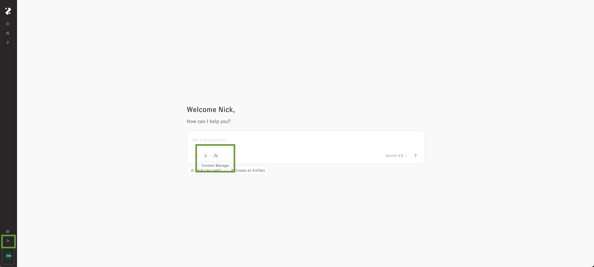 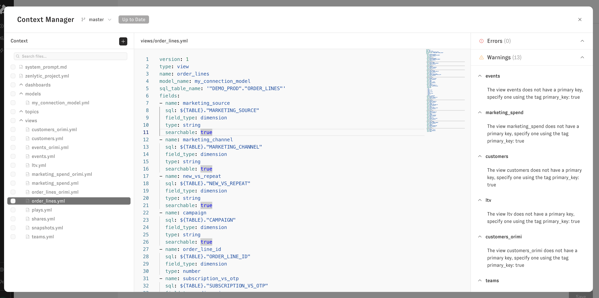

## Manage files

Use the file tree to organize and maintain your data model:

* Create files and folders
* Rename files and folders
* Open view and model files in the editor
* Access file actions beside the path or by right-clicking a folder in the file tree.

Use the three-dot menu to:

* Show documentation for view and model files
* Open database preview for view files

To rename a folder on a writable branch, open the three-dot menu beside its path or right-click it in the file tree, select **Rename**, enter the new name, and select **Commit Changes**. If the folder is referenced by `zenlytic_project.yml`, update those paths too; otherwise, the files it contains may no longer load.

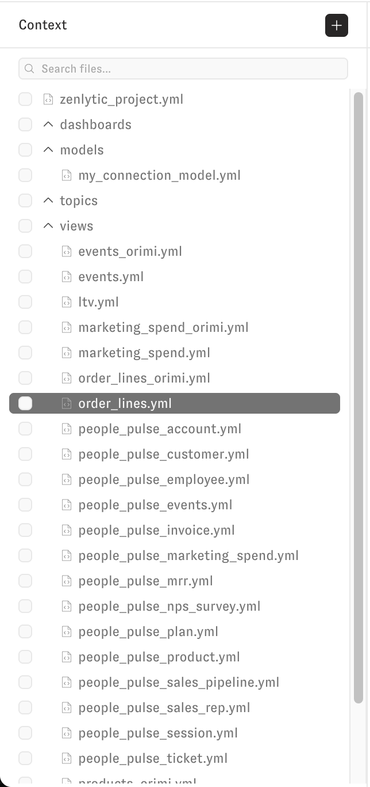 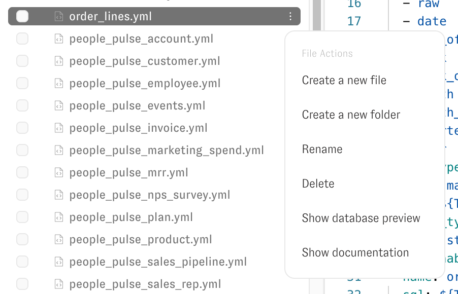

## Add to the data model

Use the **Add** button to create or upload assets:

* **Add view**
* **Add model**
* **Add skill**
* **Create file**
* **Create folder**
* **Upload file**

When you add a view, choose one of these options:

* Upload a CSV file
* Add from a database connection

Use an existing connection or create a new connection during setup.

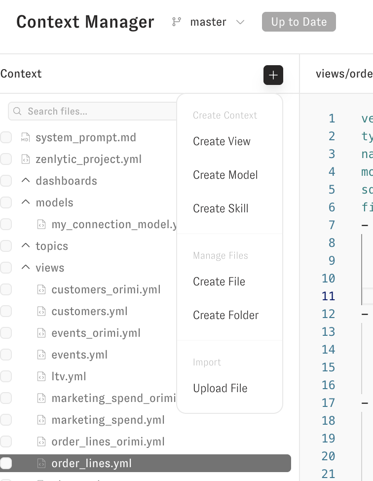 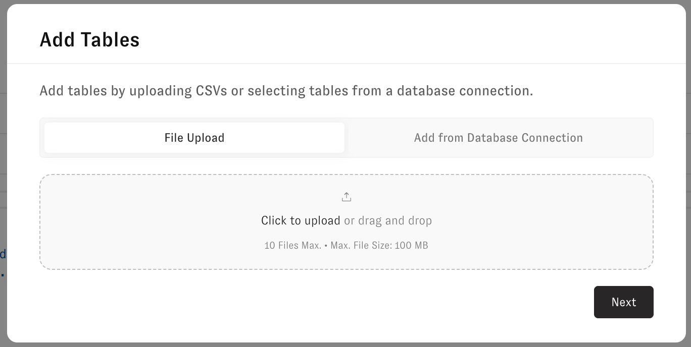

## Edit, validate, and review changes

Edit files directly in the text editor. In Compare Changes or Deploy Changes, review the changed files and their counts of additions, changes, and removals. Select a file in the file tree to inspect it. For an edited view, use **Show only changed** to focus on modified rows, or switch to **Code** to inspect the YAML diff.

Compare Changes shows the changes made on your branch, rather than changes made on production while the branch was open. Open the status indicator to review conflicts and validation results before deploying. You can inspect a changed file from its path and use its available actions to open it, add it to chat, or revert it.

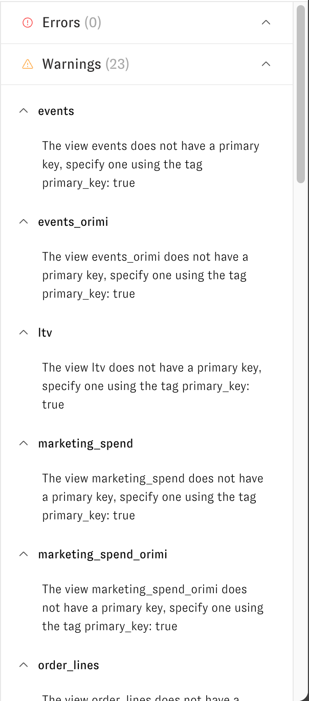 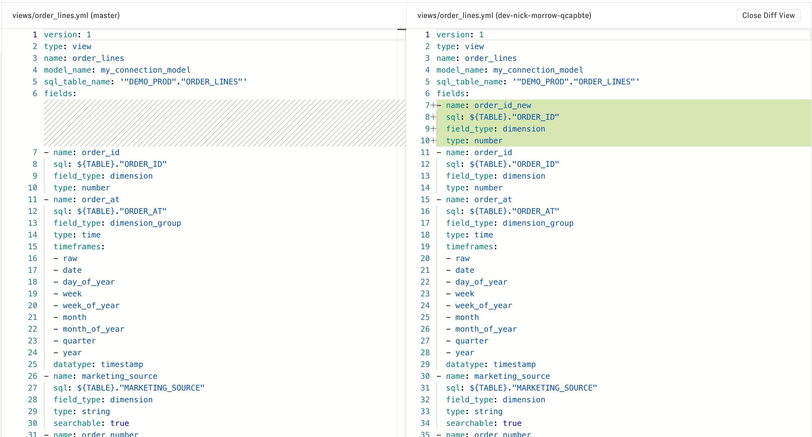

Review YAML key documentation by hovering over keys in the text editor.

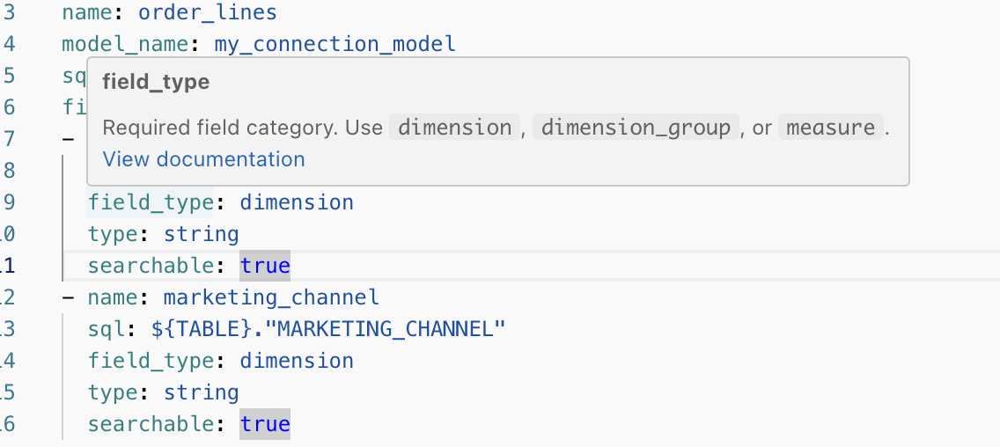

## Work with branches safely

Use the branch selector to work in non-production branches.

Disable the workspace setting that allows direct edits on the production branch to enforce a branch-based workflow.

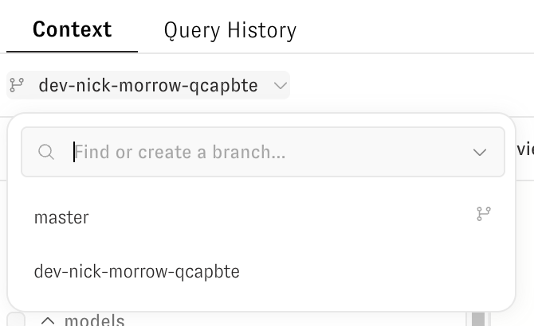 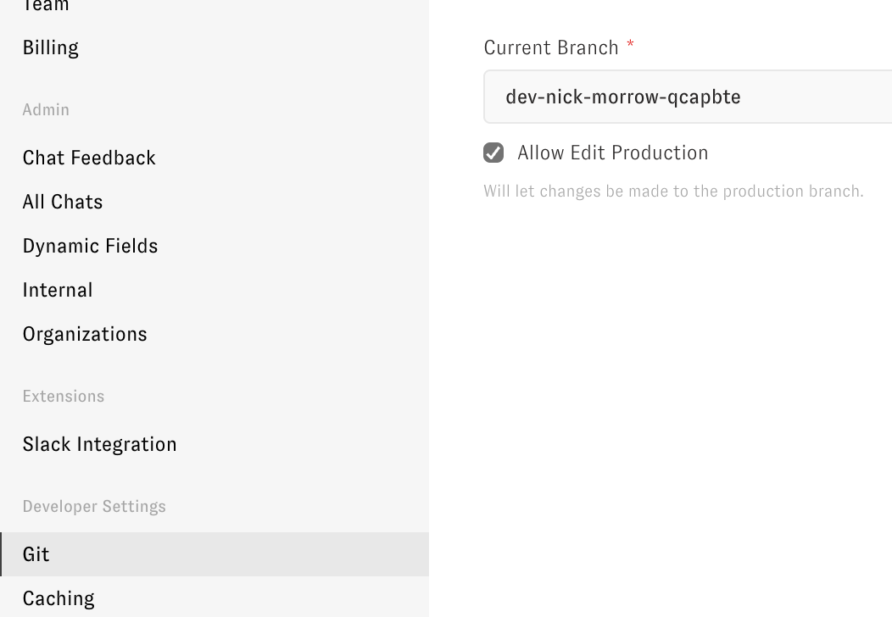

## Deploy to production

After you commit changes on a development branch, use the deploy action to publish to production.

**Deploy Changes** is unavailable while checks are running or when conflicts or blocking validation issues remain. Open the status indicator to see what needs attention, resolve the issues, then review and deploy.

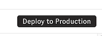
